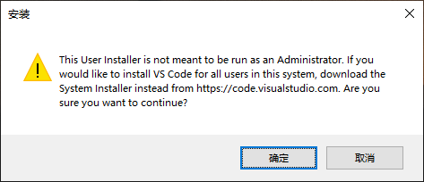
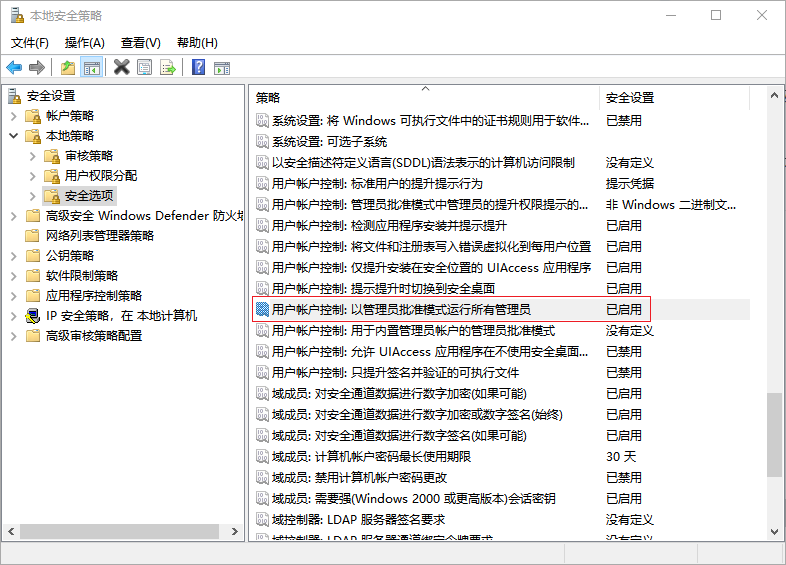

虽然 Windows 账户是管理员账户，但正常情况下，每次打开应用都是以普通用户权限运行的——需要提权时才弹 UAC 让你确认。

而我的电脑不知道从什么时候开始，每次打开应用都是管理员权限，即使并没有右键「以管理员身份运行」。

这个问题是我在安装 VS Code 的 User 版本时发现的，后来发现连 cmd 窗口左上角都提示「管理员」。

VS Code 安装时的提示是这样的：



而且进入 VS Code 之后，菜单里也找不到「检查更新」这个选项（User 版本装成了「全员安装」的样子，就没法自更新了）。

## 临时办法：runas 降权

先找到的这篇文章：[fix-user-scope-installation-error](https://notoow.github.io/fix-user-scope-installation-error/)

里面给了一个脚本，把想打开的软件拖到 bat 脚本上，就能以普通用户权限打开它：

```bat
@echo off
title RunAsUser - Force User Scope
echo ============================================
echo   RunAsUser - De-elevate Admin Privileges
echo ============================================
echo.
echo [INFO] Drag and drop your installer onto this .bat file,
echo        or enter the filename below.
echo.

if "%~1"=="" (
    set /p target="Enter installer filename (with extension): "
) else (
    set "target=%~1"
)

echo.
echo [EXECUTING] runas /trustlevel:0x20000 "%target%"
echo.

runas /trustlevel:0x20000 "%target%"

echo.
echo [DONE] If you see the installer, it worked!
pause
```

原理是：Windows UAC 会为管理员用户创建两个访问令牌，一个提权令牌、一个普通用户令牌。`runas /trustlevel:0x20000` 强制进程使用普通用户令牌，等于把权限「降」下来。

| trustlevel | 含义 |
| --- | --- |
| `0x20000` | Basic User（脚本里用的） |
| `0x40000` | Administrator |

但这只是权宜之计，不是一劳永逸的方案——我总不能每个软件都拖一遍脚本吧。

## 彻底解决：开启「管理员批准模式」

经过一番折腾，最终找到了根源：本地安全策略里的一个开关被关掉了。

1. 按 `Win + R`，输入 `secpol.msc` 回车，打开「本地安全策略」
2. 依次展开「安全设置」→「本地策略」→「安全选项」
3. 在右侧列表中找到「**用户帐户控制：以管理员批准模式运行所有管理员**」
4. 双击它，设置为「**已启用**」（这才是 Windows 默认的安全状态）
5. 重启电脑



如果这一项是「已禁用」，那么由于账户本身就是管理员账户，打开所有软件都会直接带上管理员权限，UAC 也不再拦截。

改回「已启用」并重启之后，新开的程序就都会以普通用户权限运行了，只有真正需要提权的时候才会弹窗询问。

至于这个开关是被什么软件改掉的，我没查到，只能说平时少用那些号称「一键优化」「关掉 UAC 弹窗」的工具。
